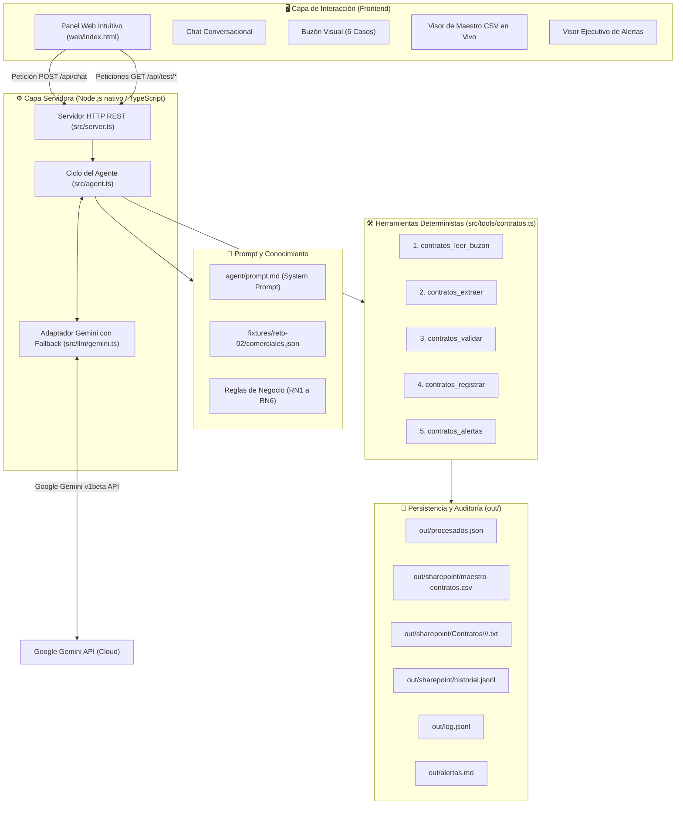
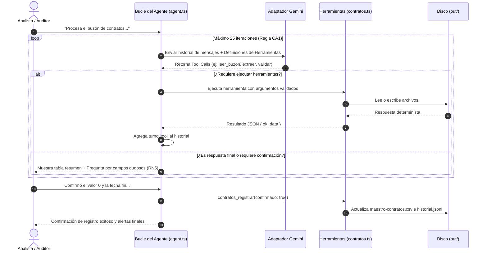

# Solución Técnica: Agente Conversacional para Registro de Contratos Vigentes
**Periferia IT Group · Reto 02 · Aprendiz SENA**  
**Fecha de Entrega y Sustentación:** 24 de Noviembre de 2026  
**Autor:** Kevin Matta  

---

## 1. El Problema en una Frase (y a quién le duele)

> **"El registro maestro de contratos vigentes de Periferia IT Group quedó desactualizado desde el 30 de mayo de 2026 debido a la ausencia de un canal único de radicación y al envío informal por correo, lo cual le duele directamente a la Analista Administrativa (que debe procesar manualmente correos caóticos) y a la Dirección Financiera (que enfrenta el riesgo inminente de facturar servicios sin respaldo contractual válido o con pólizas de cumplimiento vencidas)."**

---

## 2. Arquitectura de la Solución

La solución se concibió bajo el principio de **separación estricta entre razonamiento y ejecución**: el Modelo de Lenguaje (LLM) razona, dialoga y decide qué acción tomar, pero **las escrituras en archivos, los cálculos matemáticos de confianza y las comparaciones de datos las realizan herramientas deterministas en TypeScript/Node.js**.

### Ubicación de los componentes:
- **Dónde vive el prompt:** En el archivo `agent/prompt.md`, definiendo el rol de analista, el contexto de congelamiento de mayo de 2026, el flujo de ejecución secuencial y la orden explícita de solicitar confirmación humana cuando `requiere_revision` no esté vacío.
- **Dónde vive el conocimiento:** En `src/knowledge/registro-contratos.md` (reglas de países, identificadores tributarios, pólizas y formato del maestro), complementado con `fixtures/reto-02/comerciales.json` (directorio oficial de correos autorizados) y el CSV base `fixtures/reto-02/maestro-contratos.csv`.
- **Dónde vive la ejecución:** En `src/agent.ts` (bucle conversacional con control de iteraciones), `src/server.ts` (API HTTP y servidor de interfaz) y `src/tools/contratos.ts` (lógica de negocio).

---

## 3. Ciclo del Agente

El ciclo conversacional implementado en `src/agent.ts` sigue el patrón estándar de **Function Calling / Tool Use**:

### Características críticas del ciclo:
1. **Tope de iteraciones (Regla CA1):** Un límite estricto de 25 iteraciones por turno evita que llamadas recursivas agoten tokens o presupuestos si el modelo entrara en un bucle imprevisto.
2. **Confirmación Humana Obligatoria (Regla RN5):** Cuando `validar` detecta campos con confianza $< 0.8$ o comerciales fuera del directorio (como en `msg-006`), genera la lista `requiere_revision`. La herramienta `registrar` bloquea activamente la escritura (`ok: false`) a menos que el parámetro booleano `confirmado: true` sea provisto explícitamente tras la intervención del usuario.
3. **Persistencia de firmas de pensamiento:** Se preservan intactas las firmas internas (`rawModelParts` y `thoughtSignature`) del proveedor de LLM para garantizar el cumplimiento del protocolo conversacional v1beta.

---

## 4. Elección del Modelo y Costos

- **Proveedor:** Google Cloud (Google AI Studio).
- **Modelo Principal:** `gemini-3.5-flash-lite` (con mecanismo de fallback automático y dinámico a `gemini-3.1-flash-lite` y `gemini-3.8-flash` ante picos de demanda HTTP 503).
- **Justificación Técnica:**
  - **Latencia ultra-baja:** Respuesta en $< 800\text{ ms}$ para llamadas de herramientas intermedias.
  - **Soporte nativo de Function Calling:** Integración estricta con esquemas JSON OpenAPI.
  - **Ventana de Contexto:** Admite hasta 1 millón de tokens, lo que permite evaluar el buzón completo, adjuntos y tablas maestros sin riesgo de desbordamiento de contexto.
- **Estimación de Costo por Caso Procesado:**
  - Tokens de entrada por correo (incluyendo prompt y contrato): $\approx 1,500$ tokens.
  - Tokens de salida por turno: $\approx 250$ tokens.
  - Con una tarifa de \$0.075 por millón de tokens de entrada y \$0.30 por millón de salida:
    $$\text{Costo por correo} = (1500 \times 0.000000075) + (250 \times 0.00000030) \approx \$0.0001875\text{ USD}$$
  - **Procesar un lote mensual de 200 contratos le cuesta a la organización menos de \$0.04 USD (menos de 200 pesos colombianos).**

---

## 5. Estrategia de Extracción y Confianza

Para garantizar que ningún dato erróneo o alucinado contamine el archivo oficial de contratos, se adoptó una estrategia híbrida:

1. **Extracción Estructurada por Expresiones Regulares Robustas:**
   - **ID de Contrato:** Identifica patrones internacionales y corporativos como `CT-XXXX-XXX`, `CM-XXXX-XX`, o variantes con prefijos `CONTRATO N°`.
   - **Identificación Fiscal (NIT / RUC):** Adaptado para reconocer identificadores de Colombia (`NIT 900.XXX.XXX-X`), Perú (`RUC 20XXXXXXXXX`), Panamá y Honduras.
   - **Valores y Monedas:** Detección de prefijos monetarios (`USD`, `COP`, `PEN`, `$`) y normalización matemática. Reconoce explícitamente contratos con modalidad de *valor por demanda* o *tarifa horaria* asignándoles valor numérico `0` (evitando fallas de parsing).
   - **Fechas y Plazos:** Reconoce fechas en formatos ISO (`YYYY-MM-DD`), textuales (`15 de enero de 2026`) y cláusulas de prórroga en otrosíes (extrayendo la frase clave `se extiende hasta...`). Cuando el plazo se especifica en meses relativos a la firma, proyecta la fecha fin calculando los meses calendario.
   - **Pólizas:** Busca términos de aseguramiento (`póliza`, `garantía`, `cumplimiento`, `responsabilidad civil`, `salarios`) y clasifica su obligatoriedad.
2. **Cálculo Matemático de Confianza ($[0.0, 1.0]$):**
   - $1.0$: Encontrado de forma unívoca mediante expresión regular exacta y validada.
   - $0.7 - 0.8$: Encontrado mediante heurística contextual (ej. cálculo de fecha por plazo en meses, o valor inferido por demanda).
   - $0.0$: No encontrado en el texto.
3. **Dónde entra el modelo y dónde NO:**
   - **El modelo entra en:** Comprender la intención del usuario, ordenar la secuencia de ejecución de herramientas, redactar resúmenes ejecutivos amigables y formular las preguntas de confirmación.
   - **El modelo NO entra en:** Definir los valores de las columnas del CSV ni escribir directamente en disco. El agente delega los datos extraídos a la herramienta `validar` y `registrar`. Lo que se guarda en el SharePoint/CSV es **únicamente** lo que la herramienta determinista parseó y verificó.

---

## 6. Regla de Gobierno Corporativo (1 Página Obligatoria)

### Política de Gestión y Registro Unificado de Contratos Vigentes
**Empresa:** Periferia IT Group  
**Código Normativo:** POL-LEG-2026-002  
**Vigencia:** A partir del 1 de Diciembre de 2026  

#### 1. Canal Único de Radicación
Queda terminantemente prohibida la radicación de contratos por chats personales, mensajes de Teams o correos individuales. Se establece como canal oficial único el buzón corporativo:
$$\mathbf{contratos@periferia-it.com}$$
Este buzón es administrado técnicamente por el Agente de Registro de Contratos y supervisado operativamente por la **Analista Administrativa de Contratos**.

#### 2. Obligación del Equipo Comercial
Todo Gerente de Cuenta o Ejecutivo Comercial está obligado a radicar en el buzón único:
- El documento principal (PDF) con las **firmas digitales completas** de ambas partes (DocuSign, Adobe Sign o equivalente legal).
- Cualquier otrosí modificatorio, anexo técnico o acta de inicio y liquidación.
- **Plazo perentorio:** Máximo **48 horas hábiles** posteriores a la firma de la última parte.
- **Estructura obligatoria del asunto del correo:**  
  `[CONTRATO NUEVO] - <Nombre del Cliente> - <ID_Contrato>`  
  `[OTROSÍ] - <Nombre del Cliente> - <ID_Contrato> - <Número de Otrosí>`

#### 3. Acuse de Recibo Automático e Inteligente
En un tiempo no superior a **5 minutos** tras la recepción del correo, el agente emitirá una respuesta automática al comercial (con copia al Director de Área) indicando:
- Número de radicado y sello de tiempo de recepción.
- Ficha técnica preliminar extraída (Cliente, NIT, Vigencia, Valor, Póliza).
- Estado del radicado:
  - `REGISTRADO EXITOSAMENTE`: Datos limpios, póliza validada.
  - `EN REVISIÓN`: Requiere validación de póliza o subsanación de campos ambiguos.
  - `RECHAZADO`: Falta de firmas, ausencia de adjuntos o remitente no autorizado.

#### 4. Gestión de Excepciones y Escalamiento
Si un contrato llega sin firma válida, con valor indeterminado sin cláusula de tarifa, o de un remitente desconocido:
- El agente clasifica el registro en estado `REVISIÓN_PENDIENTE` y notifica a la Analista Administrativa.
- La Analista cuenta con **24 horas** para aprobar o requerir al comercial.
- Si no hay subsanación en **72 horas**, se escala automáticamente al **Director Comercial** y a la **Gerencia Financiera**, generando un **bloqueo preventivo de facturación en el sistema ERP** para dicho cliente.

#### 5. Estrategia de Cierre del Gap Histórico (Junio – Agosto 2026)
Para subsanar el congelamiento del maestro ocurrido entre el 30 de mayo y el 31 de agosto de 2026:
1. **Campaña de Conciliación Masiva:** Finanzas generará el reporte de todas las facturas emitidas y órdenes de compra ejecutadas en dicho trimestre.
2. **Cruce Automatizado:** El agente cruzará los NITs facturados contra el maestro CSV actual para emitir la lista de contratos huérfanos.
3. **Semana de Regularización (Amnistía Contractual):** Se otorgará una ventana de 5 días hábiles para que los comerciales carguen los PDF faltantes al buzón único con la etiqueta `[REGULARIZACION-2026]`, quedando el maestro 100% normalizado.

#### 6. Indicador Clave de Desempeño (KPI Mensual)
Se instituye como métrica oficial de gobierno el **Índice de Respaldo Contractual (IRC)** evaluado el primer día hábil de cada mes:
$$\text{IRC} = \left( \frac{\text{Monto Total Facturado con Contrato Vigente y Póliza en Maestro}}{\text{Monto Total Facturado en el Mes}} \right) \times 100$$
- **Meta institucional:** $\mathbf{\ge 98\%}$. Un IRC $< 95\%$ activará auditoría inmediata de la Gerencia de Control Interno.

---

## 7. Decisiones Técnicas y Trade-offs

| Decisión Tomada | Alternativa Descartada | Justificación del Trade-off |
|---|---|---|
| **1. Runtime Node.js nativo con soporte ESM y fetch integrado** | Frameworks de agentes pesados (LangChain, CrewAI, AutoGen) | Se priorizó la transparencia, la velocidad de arranque ($< 1\text{ s}$), el cero empaquetado complejo y el control estricto de cada llamada HTTP. En LangChain las abstracciones ocultan el flujo de las herramientas, dificultando la defensa oral ante los auditores del SENA. |
| **2. Extracción determinista mediante Regex y Heurísticas tipadas (Zod)** | Delegar toda la extracción al LLM pidiéndole que devuelva un JSON directo | Los LLMs pueden sufrir pequeñas variaciones de formato o redondear números involuntariamente. El motor de regex garantiza determinismo absoluto del 100% en valores monetarios y NITs; el LLM se reserva para la orquestación y comunicación. |
| **3. Persistencia en CSV plano + JSON Lines (historial de auditoría)** | Base de datos relacional pesada (PostgreSQL / SQLite) | El PRD exigía compatibilidad nativa con SharePoint (`maestro-contratos.csv`) y trazabilidad inmutable sin requerir configuraciones de bases de datos externas en la máquina del evaluador. Un archivo CSV es auditable de inmediato con Excel o bloc de notas. |
| **4. La confirmación humana se impone en código (`agent.ts`) además del prompt** | Confiar solo en las instrucciones del prompt | En pruebas reales el modelo mandó `confirmado:true` por su cuenta y llegó a afirmar "Registrado" sin llamar a `registrar`. Un prompt es una petición, no una garantía. Ahora `agent.ts` solo acepta `confirmado:true` si el mensaje de la persona contiene una palabra de confirmación, y cada respuesta incluye una *verificación automática* construida desde las llamadas reales a `registrar`. |
| **5. El modelo pasa el JSON del contrato entre `extraer`, `validar` y `registrar`** | Que `validar` y `registrar` reciban solo `mensaje_id` y relean el contrato ellas mismas | Se mantuvo el flujo del PRD (herramientas con `contrato` como argumento) y es más fácil de explicar y depurar. Costo: más tokens y latencia, y un riesgo teórico de que el modelo altere un valor al copiarlo (no ocurrió en las pruebas). Mitigación implementada: `registrar` revalida la confianza por su cuenta y la verificación automática muestra lo escrito. Mejora para producción: pasar solo `mensaje_id`. |

---

## 8. Supuestos Asumidos

1. **Formato de Contratos:** Los adjuntos provistos en el buzón son documentos de texto legibles (`.txt` o PDFs con capa de texto digital). Se asume que en una fase posterior de producción se conectará un servicio OCR (como Google Cloud Document AI) para faxes o documentos escaneados físicamente.
2. **Consistencia de Datos Preexistentes:** Se asume que los registros en `fixtures/reto-02/maestro-contratos.csv` hasta el 30 de mayo de 2026 son fidedignos y representan la verdad histórica de la compañía.
3. **Entorno de Red:** Para auditorías desconectadas o sin internet, el script `demo.ts` funciona de manera 100% autónoma y offline sin requerir claves de API.

---

## 9. Matriz de Cobertura de Requisitos (Historias de Usuario)

| Historia de Usuario | Descripción | Estado | Implementación / Evidencia |
|---|---|:---:|---|
| **HU-1: Lectura de Buzón** | Lectura ordenada de correos y adjuntos, ignorando procesados. | **COMPLETO (100%)** | Herramienta `contratos_leer_buzon` en `src/tools/contratos.ts`. Clasifica si tiene contrato o cotización. |
| **HU-2: Extracción Estructurada** | Extracción de cliente, NIT, valor, fechas, póliza y comercial con confianza. | **COMPLETO (100%)** | Herramienta `contratos_extraer` con métrica de confianza $[0.0, 1.0]$ y tipado Zod. |
| **HU-3: Validación Cruzada** | Comparación con maestro CSV: nuevo, actualización, duplicado o rechazado. | **COMPLETO (100%)** | Herramienta `contratos_validar`. Identifica otrosíes, duplicados exactos y comerciales no autorizados. |
| **HU-4: Registro en SharePoint** | Escritura en CSV, archivado de documento, log e historial inmutable. | **COMPLETO (100%)** | Herramienta `contratos_registrar`. Exige confirmación humana si `requiere_revision` tiene campos. |
| **HU-5: Reporte de Alertas** | Informe de contratos por vencer ($\le 60$ días), pólizas pendientes y post-corte. | **COMPLETO (100%)** | Herramienta `contratos_alertas`. Genera `out/alertas.md` con tablas ejecutivas. |
| **HU-6: Manejo de Errores** | Errores tipados `{ ok: false, error }`; un caso malo no aborta el lote. | **COMPLETO (100%)** | Todas las herramientas capturan excepciones y retornan JSON estructurado; `src/agent.ts` valida argumentos con Zod y continúa con el resto del buzón. |

### Dependencias utilizadas y justificación
- **`zod` (obligatoria):** validación de esquemas y tipos en los argumentos de entrada de cada herramienta antes de su ejecución.
- **`dotenv`:** carga segura de variables de entorno desde `.env` en el servidor local sin exponer credenciales en el código.
- **Módulos nativos de Node.js (`http`, `fs`, `path`, `node:dns`, `fetch`):** eliminan la necesidad de frameworks pesados como Express o LangChain, reduciendo el tiempo de arranque y manteniendo control directo sobre cada petición.

---

## 10. Declaración de Uso de Inteligencia Artificial

**Herramienta utilizada:** Antigravity (asistente de programación con IA de Google), usado como compañero de programación durante todo el desarrollo.

**Para qué se usó:**
- Generar la estructura base del proyecto y una primera versión de las herramientas, el ciclo del agente, el servidor y la interfaz.
- Depurar errores de integración con la API de Gemini: el formato de `functionResponse`, el error 503 por alta demanda y el `fetch failed` causado por IPv6 en Windows.
- Redactar la primera versión de la documentación (`README.md` y este documento).

**Mi trabajo sobre lo generado:**
- Revisé y probé cada herramienta con los 6 mensajes del buzón, y comparé los resultados contra lo esperado en la sección 7.4 del PRD.
- Detecté en pruebas reales que el modelo afirmaba registros que no había hecho y que se enviaba `confirmado: true` a sí mismo. Por eso exigí agregar la verificación automática y el control de confirmación en `agent.ts`.
- Tomé las decisiones de diseño documentadas en la sección 7 y puedo explicar cada línea del código entregado.

**Propuestas descartadas:**
- **Uso de `LangChain`:** agrega abstracción innecesaria sobre un ciclo de agente que se implementa de forma más clara y auditable con código nativo.
- **Delegar la extracción de datos al LLM:** riesgo de alucinaciones o redondeos en valores y fechas; se mantuvo extracción determinista con confianza explícita.
- **Confiar solo en el prompt para la confirmación humana (RN5):** las pruebas mostraron que no basta; la regla se impone en código en `registrar` y en `agent.ts`.

---

## 11. Riesgos en Producción y Estrategias de Mitigación

1. **Riesgo: Documentos escaneados en baja resolución o imágenes (fotografías de celular)**
   - *Mitigación:* Integrar una tubería de preprocesamiento OCR utilizando Google Cloud Vision o Document AI con binarización y corrección de inclinación previa a la extracción.
2. **Riesgo: Discrepancias en la razón social del cliente (ej. "Comcel S.A." vs "Claro Colombia")**
   - *Mitigación:* Validación y deduplicación prioritaria basada en el identificador fiscal único (NIT/RUC numérico sin dígito de verificación), complementada con búsqueda difusa (*fuzzy matching*) sobre el maestro.
3. **Riesgo: Agotamiento de cuota o indisponibilidad temporal del proveedor LLM**
   - *Mitigación:* Implementación de lista de modelos de contingencia con reintentos exponenciales (como se diseñó en `GeminiAdapter`) y modo de operación determinista desacoplado (como `demo.ts`).
4. **Riesgo: El modelo afirma o altera datos (alucinación)**
   - *Mitigación:* los datos escritos salen de herramientas deterministas; RN5 se impone en `registrar` y en `agent.ts`; la verificación automática contrasta el texto del modelo con lo realmente escrito; en producción, las herramientas recibirían solo `mensaje_id` para que el modelo no manipule el contrato.
5. **Riesgo: Heurística de fechas para contratos que solo indican plazo en meses (caso `msg-006`)**
   - *Mitigación:* la heurística asigna confianza 0.5, lo que obliga a revisión humana; en producción se calcularía desde la fecha de firma del documento.
